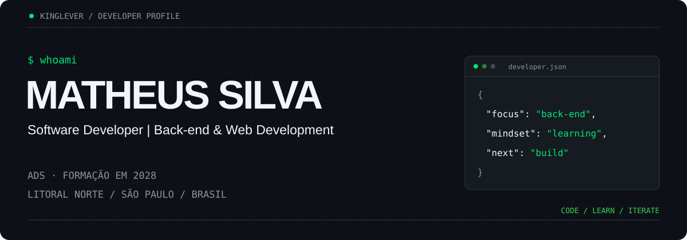
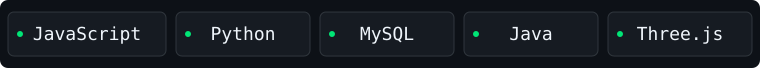

  

**Desenvolvedor em formação · Back-end & Web Development**

  

[Sobre mim](#sobre-mim) · [Tecnologias](#tecnologias--ferramentas) · [Projetos](#projetos-em-destaque) · [GitHub Analytics](#github-analytics) · [Contato](#contato)

## Sobre mim

Sou **Matheus Conceição Silva**, estudante de **Análise e Desenvolvimento de Sistemas**, com conclusão prevista para **2028**, no Litoral Norte de São Paulo.

Construo minha experiência com projetos acadêmicos, aplicações web e experimentos em Python. Meu foco de desenvolvimento é o **back-end**, com interesse em organização de código, bancos de dados relacionais e arquitetura de software. Atualmente, aprofundo meus estudos em PHP, Java, JavaScript, Python e MySQL.

Busco oportunidades para aplicar esses conhecimentos em projetos reais, aprender com outros desenvolvedores e colaborar na construção de software bem estruturado.

## Tecnologias & Ferramentas

As categorias abaixo distinguem o que aparece no código público do meu roteiro de aprendizado. Não representam níveis de proficiência.

| Categoria | Evidência nos projetos públicos | Estudos e próximos passos |
| :--- | :--- | :--- |
| Linguagens | **JavaScript** · **Python** | PHP · Java; aprofundamento em JavaScript e Python |
| Desenvolvimento Web | **HTML5** · **CSS3** · Three.js | Bootstrap |
| Bancos de Dados | Ainda sem implementação pública identificada | MySQL · PostgreSQL |
| Ferramentas | **GitHub** — versionamento dos projetos | Git · Docker · VS Code — roteiro de ferramentas |
| Conceitos | Manipulação do DOM · visualização 3D · pipeline de processamento de imagens | MVC · CRUD · orientação a objetos · back-end · bancos relacionais · testes automatizados |

## Projetos em destaque

### 01 / [Motherboard — Atlas 3D](https://github.com/KingLever/motherboard)

Exploração educativa de uma placa-mãe em 3D, com seleção de componentes, rotação, zoom e navegação por tópicos. O modelo é construído com geometrias no próprio código.

**JavaScript · Three.js · HTML · CSS**  
**Status:** demonstração publicada; projeto de visualização interativa.

[Explorar demonstração ↗](https://kinglever.github.io/motherboard/) · [Ver código](https://github.com/KingLever/motherboard/blob/main/app.js)

### 02 / [LatentFusion](https://github.com/KingLever/LatentFusion)

Protótipo experimental de síntese facial com etapas separadas para preparação, alinhamento, codificação, fusão e restauração de imagens. O código inclui orquestração de scripts e geração de relatórios de erro.

**Python · PyTorch · NumPy · OpenCV**  
**Status:** protótipo experimental. A execução depende de modelos externos, configuração de ambiente e caminhos locais; não há demonstração web validada.

[Explorar pipeline](https://github.com/KingLever/LatentFusion/blob/main/run_pipeline.py) · [Documentação](https://github.com/KingLever/LatentFusion#readme)

### 03 / [One Piece — narrativa interativa](https://github.com/KingLever/one-piece)

Estudo de navegação por escolhas: botões alternam as etapas da narrativa por meio de eventos e manipulação do DOM, com telas de introdução e áudio.

**HTML · CSS · JavaScript**  
**Status:** estudo com implementação disponível; sem demonstração publicada confirmada.

[Ver repositório](https://github.com/KingLever/one-piece) · [Lógica de navegação](https://github.com/KingLever/one-piece/blob/main/script.js)

<strong>Próximo projeto / CRUD com PHP + MySQL</strong>

Projeto planejado para praticar cadastro, consulta, atualização e exclusão com organização MVC. Ainda não apresentado como implementação pública. A documentação e o link serão adicionados quando o código estiver disponível.

## GitHub Analytics

Minha atividade e a distribuição de linguagens podem ser consultadas diretamente no GitHub:

- [Contribuições e atividade pública](https://github.com/KingLever?tab=overview)
- [Repositórios e linguagens por projeto](https://github.com/KingLever?tab=repositories)

As linguagens dos projetos descrevem o código publicado, sem equivaler a um nível de domínio. As contribuições são exibidas pelo próprio GitHub; não há contadores mantidos manualmente.

## Contato

Aberto a conversar sobre oportunidades de aprendizado, projetos e colaboração.

[**GitHub / @KingLever ↗**](https://github.com/KingLever)

<!-- Adicionar e-mail profissional somente após confirmação. LinkedIn e portfólio dependem de links fornecidos pelo autor. -->

---

Matheus Silva · Back-end & Web Development · Aprendizado contínuo, um projeto por vez.
